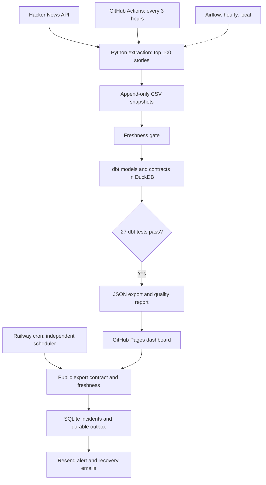

# HN Pulse

[](https://github.com/VasilenData/hn-pulse/actions/workflows/pipeline.yml) [](LICENSE) 

An end-to-end data engineering project: a scheduled pipeline snapshots the Hacker News front page, models it with **dbt** under enforced data contracts and 27 dbt data tests, and publishes a **live dashboard with data freshness and last-run quality results**.

**Live dashboard: https://vasilendata.github.io/hn-pulse/**

**Stack:** Python · DuckDB · dbt · GitHub Actions · GitHub Pages · Railway · SQLite · Resend. Apache Airflow is an optional local orchestration example.

**Operating status:** GitHub Actions is scheduled to run the public pipeline every three hours; actual starts can be delayed. GitHub Pages serves the dashboard. A separate Railway cron checks the public export twice hourly and sends incident/recovery emails through Resend. The Airflow DAG runs locally and is not the scheduler for the live site.

**Operating evidence:** The [12 November 2026 review](docs/operations-review-2026-11-12.md) records an independently detected 6.38-hour stale export, restored publication, durable alert/recovery delivery across hosted restarts, and an email drill with verified inbox receipt. The earlier [8 November review](docs/operations-review-2026-11-08.md) covers 50 successful runs out of 52 completed pipeline runs. These are dated observations, not uptime or detection-time guarantees.

## Architecture



## Data quality: five layers of defence

| Layer | What it catches | Where |
|---|---|---|
| **Extraction validation** | Empty or incomplete snapshots, invalid or duplicate API IDs | `extract.py` requires at least 90 of the requested 100 stories before appending history |
| **Freshness gate** | Stale, missing, invalid, or implausibly future snapshot timestamps | `quality.py gate`, run before dbt |
| **Schema contracts** | A column changes name or type and breaks the dashboard downstream | `models/schema.yml`, enforced on all 6 models |
| **27 data tests** | Nulls, duplicates, negative scores, broken keys, partial API responses | `models/schema.yml`, `tests/` |
| **Health report** | Last-run check results and overdue exported data | `quality.py` writes absolute timestamps and results into `data.json`; the browser computes current age |

I tested that these actually fire, by breaking the pipeline on purpose:

* Changing a mart column to a different type: dbt refused to build the table (contract error).
* Adding a snapshot with only one story and a negative score: `non_negative` and `assert_snapshot_completeness` failed, and dbt skipped the remaining 21 steps, so nothing was published.

A freshness gate that never fails proves nothing, so `test_quality.py` also checks that stale data does fail it. The lineage diagram is generated from dbt's manifest by `lineage.py`, so it cannot drift from the code: see [LINEAGE.md](LINEAGE.md).

### Freshness that keeps aging

The export records `quality.newest_snapshot_at` as an absolute UTC timestamp, alongside `generated_at`. The browser calculates age from those timestamps every minute and checks for a newer JSON export every five minutes while the tab is visible, and when returning to the tab. It never uses a frozen build-time age as the current age. The deprecated numeric `newest_snapshot_age_hours` field remains in the export for older cached dashboard pages; the current page ignores it.

The public schedule is every **3 hours**. The dashboard flags data as overdue after **6 hours**, allowing one extra interval for delayed Actions runs. Either an old source snapshot or an old export triggers the warning. Missing timestamps and a device clock more than five minutes behind an export produce an explicit unavailable/clock warning. Refresh requests time out after 15 seconds, and the page validates the fields it renders before replacing the last loaded data. A failed or malformed refresh preserves that data and says that a newer export could not be checked.

Both the snapshot append and JSON export use a temporary file followed by replacement. A write or serialization failure preserves the previous complete history and export. The export writer orders each mart explicitly and rejects non-finite numeric values instead of producing invalid JSON. Direct `python export.py` calls also require dbt health artifacts, completed data tests, successful full model coverage and enforced contracts. Missing, failed or partial builds preserve the previous export; dbt warnings remain non-blocking. This checks recorded build results, not whether someone manually changed the database afterward. GitHub Actions serializes pipeline runs so they do not compete to publish; local commands should also use a single writer.

API GETs make at most three attempts for connection errors, timeouts and HTTP 429/500/502/503/504. Backoff is one then two seconds, extended by `Retry-After` up to 30 seconds; a longer requested cooldown fails the run rather than retrying early. Connect/read inactivity timeouts are 5/15 seconds, not a total wall-clock deadline. Permanent HTTP errors and malformed JSON fail immediately. Exhausted retries still fail extraction, and the existing 90% completeness and atomic-history protections remain in force.

The health section reports the last exported dbt results, not the status of a currently running GitHub job. An overdue timestamp identifies delayed published data; the [workflow runs](https://github.com/VasilenData/hn-pulse/actions/workflows/pipeline.yml) show whether a run failed, was delayed, or has not executed. Regression tests in `tests_js/` cover an export aging from fresh to stale, old data in a new export, legacy UTC timestamps, and invalid or future timestamps.

## Why this design
- **Append-only raw layer.** Every run adds a timestamped snapshot, so history is never overwritten and any model can be rebuilt from scratch.
- **dbt layers.** `stg_snapshots` (typing, domain parsing, de-duplication) -> `fct_stories` (one row per story with peak score and time on the front page) -> four marts that feed the dashboard.
- **Tests gate publishing.** `dbt build` runs 27 data tests, including custom ones (`rank_in_window`, `non_negative`, `unique_combination`, snapshot completeness); if any fail, the dashboard data is not updated.
- **Local and hosted orchestration.** The local Airflow DAG (`dags/hn_pulse_dag.py`) runs `extract >> freshness_gate >> dbt_build >> export`, with retries and no overlapping runs. GitHub Actions operates the live schedule and runs the same data-processing steps before committing the successful export for Pages.
- **Regression tests** cover parsing and incomplete API responses, stale/future/missing timestamps, atomic export failures, and a malformed browser refresh followed by recovery. Tests use local fixtures and do not call the Hacker News API.

## Run it

Without Docker:
```bash
git clone https://github.com/VasilenData/hn-pulse.git
cd hn-pulse
pip install -r requirements.txt
pytest -q                 # Python unit tests
python run_pipeline.py    # extract -> freshness gate -> dbt build -> export
python -m http.server 8000 --directory docs
# Open http://localhost:8000 in a browser; file:// does not support the JSON/module requests.
```

Dashboard regression tests use Node.js 22 and its built-in test runner, with no npm dependencies:

```bash
node --test tests_js/*.test.mjs
```

With Airflow (Docker):
```bash
docker compose up --build
# http://localhost:8080 , enable the hn_pulse DAG
```

## Project layout
```
extract.py            Hacker News API -> data/raw_snapshots.csv
models/               dbt models, data contracts and schema tests
quality.py            freshness gate and health report
lineage.py            builds LINEAGE.md from the dbt manifest
tests/                custom dbt tests (generic and singular)
export.py             marts -> docs/data.json
dags/hn_pulse_dag.py  optional local Airflow DAG
docs/                 static dashboard (GitHub Pages)
docs/freshness.mjs     browser-clock freshness assessment
docs/dashboard-data.mjs export validation and bounded fetch requests
test_export.py         atomic publication and export-order regression tests
tests_js/              dashboard freshness and refresh regression tests
.github/workflows/    pull-request checks + scheduled pipeline + publishing
```

## Limits and next steps
Pull requests run lint, Python and dashboard regressions, and a dbt build against the committed snapshot data. These checks have read-only repository permissions and do not call the live API or publish dashboard updates.

This is a small public-data product, not a large-scale throughput benchmark or an employer production system. The dataset grows with each successful run: current snapshot totals are displayed on the [dashboard](https://vasilendata.github.io/hn-pulse/), and row/story counts are in `quality.rows` in the dated [JSON export](docs/data.json). A passing last build does not guarantee the next scheduled run will succeed.

GitHub Actions scheduling can be delayed and has no project-specific uptime guarantee. The browser's freshness assessment depends on the reader's device clock; it is not an external alerting service. A cloud-warehouse port would also require validating SQL types, model behavior, permissions, and costs, rather than only changing the dbt profile.

### Publication monitor

[`monitor.yml`](.github/workflows/monitor.yml) is a separate hourly workflow that reads the live Pages `data.json`; it does not extract or run dbt. `python monitor.py` checks both source and export timestamps against a six-hour limit. Fresh observations pass; overdue, malformed, future-dated or unreachable exports fail the workflow. Every run saves a timestamped JSON observation as a 30-day Actions artifact, including failures. A network failure is labelled `unavailable`, not evidence of stale data.

This GitHub workflow adds monitoring independent of the data pipeline, but it shares GitHub's scheduler. A delayed/missing monitor run cannot report itself. Monitor results are observations, not a new uptime or SLA claim; the dated operating review remains historical.

### Independent monitor and controlled incident delivery

[`monitor_worker.py`](monitor_worker.py) adds a separately deployable cron worker with a stricter public-export contract, durable SQLite incident/outbox state, bounded requests, and Resend/SMTP email adapters. Failed delivery remains pending; repeated unhealthy checks produce one incident alert, followed by an ordered recovery notification. Stable event IDs support retry deduplication; generic SMTP is at-least-once, and Resend's deduplication window is 24 hours.

Outbox delivery now uses per-attempt fencing tokens: an expired worker cannot clear a replacement worker's lease or overwrite its receipt. A [controlled offline reproduction](docs/outbox-fencing-2026-11-12.json) demonstrates the original race and the fix using two real SQLite connections. Provider acceptance and durable local acknowledgement remain separate, and no exactly-once delivery claim is made.

The [dated operating review](docs/operations-review-2026-11-12.md) separates real observations from exercises: Railway detected an actual 6.38-hour-old publication, then a later invocation reopened persistent state and delivered the queued alert before recovery. A separate [controlled email drill](docs/email-drill-2026-11-12.json) produced one alert and one recovery, both verified in the owner-controlled inbox. The [local HTTP drill](docs/monitor-drill-2026-11-12.json) also checks repeat-incident suppression. Neither exercise changed the live export. [Deployment, incident response and delivery limits](docs/INDEPENDENT_MONITOR.md) include the 24-hour idempotency window and the monitor’s own scheduler dependency.

### Source-change impact

The dbt manifest now includes the public JSON and dashboard as [owned downstream exposures](models/exposures.yml). After `dbt parse --profiles-dir .`, run `python lineage.py --impact stg_snapshots --column score` to see affected models, tests and published consumers. This is conservative **model-level** impact: the changed column is checked against the contract, but all dependent models are included. It does not claim automatic column-level SQL lineage.

---
Built by [Vasilen Kanchev](https://vasilendata.github.io) · [LinkedIn](https://www.linkedin.com/in/vasilenkanchev/)
