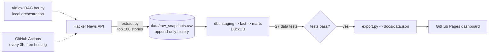

# HN Pulse

[](https://github.com/VasilenData/hn-pulse/actions/workflows/pipeline.yml) [](LICENSE) 

An end-to-end data engineering project: a scheduled pipeline snapshots the Hacker News front page, models it with **dbt** under enforced data contracts and 27 automated tests, and publishes a **live dashboard that reports its own health**.

**Live dashboard: https://vasilendata.github.io/hn-pulse/**

**Stack:** Python · DuckDB · dbt · Apache Airflow · GitHub Actions · GitHub Pages

## Architecture



## Data quality: four layers of defence

| Layer | What it catches | Where |
|---|---|---|
| **Freshness gate** | The extract step silently failed, so the data is stale | `quality.py gate`, run before dbt |
| **Schema contracts** | A column changes name or type and breaks the dashboard downstream | `models/schema.yml`, enforced on all 6 models |
| **27 data tests** | Nulls, duplicates, negative scores, broken keys, partial API responses | `models/schema.yml`, `tests/` |
| **Health report** | You cannot see whether the checks passed | `quality.py` writes it into `data.json`; the dashboard shows it |

I tested that these actually fire, by breaking the pipeline on purpose:

* Changing a mart column to a different type: dbt refused to build the table (contract error).
* Adding a snapshot with only one story and a negative score: `non_negative` and `assert_snapshot_completeness` failed, and dbt skipped the remaining 21 steps, so nothing was published.

A freshness gate that never fails proves nothing, so `test_quality.py` also checks that stale data does fail it. The lineage diagram is generated from dbt's manifest by `lineage.py`, so it cannot drift from the code: see [LINEAGE.md](LINEAGE.md).

## Why this design
- **Append-only raw layer.** Every run adds a timestamped snapshot, so history is never overwritten and any model can be rebuilt from scratch.
- **dbt layers.** `stg_snapshots` (typing, domain parsing, de-duplication) -> `fct_stories` (one row per story with peak score and time on the front page) -> four marts that feed the dashboard.
- **Tests gate publishing.** `dbt build` runs 27 data tests, including custom ones (`rank_in_window`, `non_negative`, `unique_combination`, snapshot completeness); if any fail, the dashboard data is not updated.
- **Two orchestrators, same code.** The Airflow DAG (`dags/hn_pulse_dag.py`) shows the production pattern: `extract >> dbt_build >> export`, with retries and no overlapping runs. GitHub Actions runs the same steps on a cron so the live dashboard needs no server.
- **Python unit tests** cover the parsing logic (`test_extract.py`), including dead/deleted items and text posts.

## Run it

Without Docker:
```bash
git clone https://github.com/VasilenData/hn-pulse.git && cd hn-pulse
pip install -r requirements.txt
pytest -q                 # unit tests
python run_pipeline.py    # extract -> dbt build -> export
open docs/index.html      # needs a local server: python -m http.server -d docs
```

With Airflow (Docker):
```bash
docker compose up --build
# http://localhost:8080 , enable the hn_pulse DAG
```

## Project layout
```
extract.py            Hacker News API -> data/raw_snapshots.csv
models/               dbt models, data contracts and schema tests
quality.py            freshness gate and health report
lineage.py            builds LINEAGE.md from the dbt manifest
tests/                custom dbt tests (generic and singular)
export.py             marts -> docs/data.json
dags/hn_pulse_dag.py  Airflow DAG
docs/                 static dashboard (GitHub Pages)
.github/workflows/    scheduled pipeline + publishing
```

## Limits and next steps
The data is small (about 900 rows from 9 snapshots so far); the point of the project is the engineering around it, not scale. For scale, see the benchmark project. Next: swap DuckDB for a cloud warehouse (BigQuery or Snowflake) by changing the dbt profile, and add story-level trend features.

---
Built by [Vasilen Kanchev](https://vasilendata.github.io) · [LinkedIn](https://www.linkedin.com/in/vasilenkanchev/)
