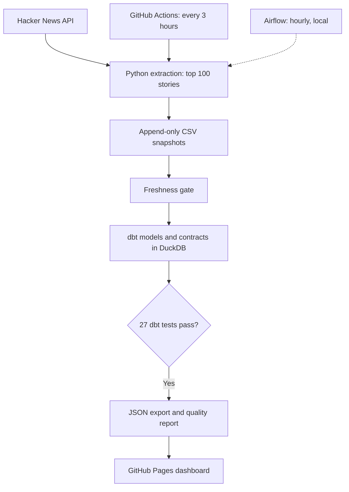

# HN Pulse

[](https://github.com/VasilenData/hn-pulse/actions/workflows/pipeline.yml) [](LICENSE) 

An end-to-end data engineering project: a scheduled pipeline snapshots the Hacker News front page, models it with **dbt** under enforced data contracts and 27 dbt data tests, and publishes a **live dashboard with data freshness and last-run quality results**.

**Live dashboard: https://vasilendata.github.io/hn-pulse/**

**Stack:** Python · DuckDB · dbt · GitHub Actions · GitHub Pages. Apache Airflow is an optional local orchestration example.

**Operating status:** GitHub Actions runs the public pipeline every three hours. GitHub Pages serves the dashboard. The Airflow DAG runs locally and is not the scheduler for the live site.

## Architecture



## Data quality: four layers of defence

| Layer | What it catches | Where |
|---|---|---|
| **Freshness gate** | The extract step silently failed, so the data is stale | `quality.py gate`, run before dbt |
| **Schema contracts** | A column changes name or type and breaks the dashboard downstream | `models/schema.yml`, enforced on all 6 models |
| **27 data tests** | Nulls, duplicates, negative scores, broken keys, partial API responses | `models/schema.yml`, `tests/` |
| **Health report** | Last-run check results and overdue exported data | `quality.py` writes absolute timestamps and results into `data.json`; the browser computes current age |

I tested that these actually fire, by breaking the pipeline on purpose:

* Changing a mart column to a different type: dbt refused to build the table (contract error).
* Adding a snapshot with only one story and a negative score: `non_negative` and `assert_snapshot_completeness` failed, and dbt skipped the remaining 21 steps, so nothing was published.

A freshness gate that never fails proves nothing, so `test_quality.py` also checks that stale data does fail it. The lineage diagram is generated from dbt's manifest by `lineage.py`, so it cannot drift from the code: see [LINEAGE.md](LINEAGE.md).

### Freshness that keeps aging

The export records `quality.newest_snapshot_at` as an absolute UTC timestamp, alongside `generated_at`. The browser calculates age from those timestamps every minute and checks for a newer JSON export every five minutes while the tab is visible, and when returning to the tab. It never uses a frozen build-time age as the current age. The deprecated numeric `newest_snapshot_age_hours` field remains in the export for older cached dashboard pages; the current page ignores it.

The public schedule is every **3 hours**. The dashboard flags data as overdue after **6 hours**, allowing one extra interval for delayed Actions runs. Either an old source snapshot or an old export triggers the warning. Missing timestamps and a device clock more than five minutes behind an export produce an explicit unavailable/clock warning. A failed refresh preserves the last loaded data and says that a newer export could not be checked.

The health section reports the last exported dbt results, not the status of a currently running GitHub job. An overdue timestamp identifies delayed published data; the [workflow runs](https://github.com/VasilenData/hn-pulse/actions/workflows/pipeline.yml) show whether a run failed, was delayed, or has not executed. Regression tests in `tests_js/` cover an export aging from fresh to stale, old data in a new export, legacy UTC timestamps, and invalid or future timestamps.

## Why this design
- **Append-only raw layer.** Every run adds a timestamped snapshot, so history is never overwritten and any model can be rebuilt from scratch.
- **dbt layers.** `stg_snapshots` (typing, domain parsing, de-duplication) -> `fct_stories` (one row per story with peak score and time on the front page) -> four marts that feed the dashboard.
- **Tests gate publishing.** `dbt build` runs 27 data tests, including custom ones (`rank_in_window`, `non_negative`, `unique_combination`, snapshot completeness); if any fail, the dashboard data is not updated.
- **Local and hosted orchestration.** The local Airflow DAG (`dags/hn_pulse_dag.py`) runs `extract >> freshness_gate >> dbt_build >> export`, with retries and no overlapping runs. GitHub Actions operates the live schedule and runs the same data-processing steps before committing the successful export for Pages.
- **Python unit tests** cover the parsing logic (`test_extract.py`), including dead/deleted items and text posts.

## Run it

Without Docker:
```bash
git clone https://github.com/VasilenData/hn-pulse.git
cd hn-pulse
pip install -r requirements.txt
pytest -q                 # Python unit tests
python run_pipeline.py    # extract -> freshness gate -> dbt build -> export
python -m http.server 8000 --directory docs
# Open http://localhost:8000 in a browser; file:// does not support the JSON/module requests.
```

Dashboard regression tests use Node.js 22 and its built-in test runner, with no npm dependencies:

```bash
node --test tests_js/*.test.mjs
```

With Airflow (Docker):
```bash
docker compose up --build
# http://localhost:8080 , enable the hn_pulse DAG
```

## Project layout
```
extract.py            Hacker News API -> data/raw_snapshots.csv
models/               dbt models, data contracts and schema tests
quality.py            freshness gate and health report
lineage.py            builds LINEAGE.md from the dbt manifest
tests/                custom dbt tests (generic and singular)
export.py             marts -> docs/data.json
dags/hn_pulse_dag.py  optional local Airflow DAG
docs/                 static dashboard (GitHub Pages)
docs/freshness.mjs     browser-clock freshness assessment
tests_js/              dashboard freshness regression tests
.github/workflows/    scheduled pipeline + publishing
```

## Limits and next steps
This is a small public-data product, not a large-scale throughput benchmark or an employer production system. The dataset grows with each successful run: current snapshot totals are displayed on the [dashboard](https://vasilendata.github.io/hn-pulse/), and row/story counts are in `quality.rows` in the dated [JSON export](docs/data.json). A passing last build does not guarantee the next scheduled run will succeed.

GitHub Actions scheduling can be delayed and has no project-specific uptime guarantee. The browser's freshness assessment depends on the reader's device clock; it is not an external alerting service. A useful next step is independent failure/overdue-publication alerting. A cloud-warehouse port would also require validating SQL types, model behavior, permissions, and costs, rather than only changing the dbt profile.

---
Built by [Vasilen Kanchev](https://vasilendata.github.io) · [LinkedIn](https://www.linkedin.com/in/vasilenkanchev/)
